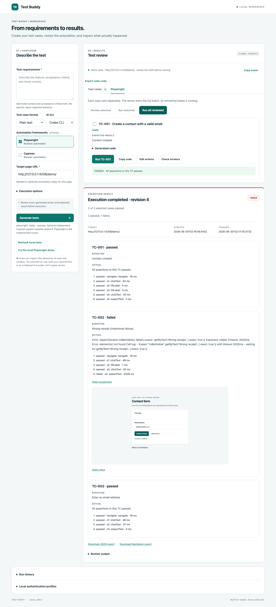

# Test Buddy

**Turn requirements into reviewed test cases and real Playwright results.**

Test Buddy is a local QA workspace that connects manual test design with browser automation. Enter your requirements and target URL, generate cases with your configured Codex or Claude CLI, review each automation mapping, and inspect what actually happened.



**New here?** Read the [detailed user guide](docs/user-guide.md) for setup, the full workflow, exports, authentication, and troubleshooting.

## Why I built it

As a manual QA analyst, I wanted one place to organize test cases and explore automation without losing the expected behavior behind each case. Test Buddy keeps manual steps, assertions, execution results, and evidence together. Every generated case has its own identity and Playwright result.

This is a personal learning project built with AI-assisted development. The focus is practical QA workflows, readable results, and honest execution status.

## Features

- **Manual test design:** generate plain-text cases from requirements.
- **Independent automation:** run one case, selected cases, or all runnable cases. Run confirms the displayed actions.
- **Clear results:** per-case verdicts, expected versus actual behavior, real steps, and assertion errors.
- **Evidence:** failure screenshots and traces, plus optional recorded video.
- **Execution controls:** headless or headed Chromium, action delay, cancellation, and reload recovery.
- **Structured editing:** edit allowlisted actions and exact locators without executing model-written source.
- **Copy and download:** copy each case or the whole suite; download test cases as text and Playwright tests as code.
- **Saved history:** reopen exact suite revisions and export execution reports as JSON or Markdown.
- **Local authentication:** explicitly capture an origin-bound login profile for authenticated testing.

## Quick start

Requirements: **Node.js 20+**, npm, and Chromium for Playwright. AI generation also needs a configured, signed-in **Codex CLI or Claude CLI**. Test Buddy starts Codex with unrelated user MCPs, plugins, and hooks excluded, while retaining your top-level model and reasoning preferences and existing sign-in. Claude runs in its safe mode: your personal `CLAUDE.md`, skills, plugins, hooks, and MCP servers are left out, no tools are available, and the request is not saved as a session, while your sign-in and model selection still apply. This needs a Claude CLI version that supports `--safe-mode`. Generation is limited to JSON output and has a five-minute total deadline, including inspection and at most one repair request. Custom Codex providers are not yet supported by this isolated invocation. The bundled demo works without an AI account.

```sh
git clone https://github.com/josenetoqa/qa-test-buddy.git
cd qa-test-buddy
npm ci
npx playwright install chromium
npm start
```

Open [http://127.0.0.1:4173](http://127.0.0.1:4173). The server binds to loopback and has no frontend build step. While this repository is private, cloning requires access to it.

Optional configuration:

```sh
PORT=4183 npm start
TEST_BUDDY_DATA_DIR=/absolute/path/to/private-data npm start
```

## Test your application

1. Enter your requirements. Cases are always generated in plain text.
2. Select your installed AI CLI and enable Playwright.
3. Enter your application's target URL and click **Generate tests**. With Playwright selected, Test Buddy first reads visible field labels, placeholder text, button and link names, the names of custom toggles and choices (switch, checkbox, radio, and combobox roles), and form scopes, and includes them in the AI request. A submit, button, or reset input is named by its `value` attribute. Text typed into fields, the current value of a custom combobox, cookies, and login tokens are excluded. Initial inspection uses a fresh browser session and never clicks controls. Optional captured states let you manually provide later or authenticated page observations. If inspection is unavailable, manual cases are still generated with blocked automation where evidence is missing. Unlabeled fields can use exact placeholder locators scoped to their observed form, keeping repeated login and registration fields separate.
4. Check the manual cases, locators, and assertions. Edit actions or check locator matches if needed.
5. Open the collapsed **Playwright code** preview, then run one case, selected cases, or all runnable cases. Clicking Run confirms the displayed actions; a separate Mark reviewed step is not needed.
6. Inspect the result panel and export the report or evidence.

Configure, Test review, and Results form one page. Configuration separates requirements and output selection from optional settings. **Your setup** shows readiness, the Generate button, and progress with a link to Test review. Execution scrolls to Results. Use **Jump to case** to navigate the automation list or **Collapse code** to close previews. Selecting cases keeps your scroll position and open previews.

Changing the requirements, URL, or Playwright selection blocks execution of the previous suite. **Use suite inputs** restores its saved inputs; generate again to use your changes. A failed generation never falls back to the demo. Saved suites restore their original inputs.

### Improve generation quality

Open **Optional test context** to add one acceptance criterion per line, a user role, preconditions, test data, and business rules. Each criterion gets a requirement ID. Review the resulting mapping, uncovered requirements, duplicate warnings, and generation metrics; these are review aids, not proof of correct coverage.

Generation shows progress and supports cancellation/reconnection. It preserves accepted cases during one targeted repair. **Regenerate case** or **Regenerate selected** creates a new revision while preserving other cases. Expected outcomes cannot be changed by selected regeneration; update requirements and generate a new suite when the behavior changes.

Initial inspection is reused for five minutes; choose **Refresh page inspection (ignore cache)** to bypass it. Under **Capture page states**, open a controlled browser, manually reach the needed state, describe its setup steps, and capture visible controls. Select snapshots to include them in generation. Captures close after five minutes and snapshots expire after 30 minutes. An optional local login profile can be used for capture; cookies and storage are not sent to AI.

For details and benchmark commands, see [generation quality and efficiency](docs/generation-quality.md).

### Edit actions and inspect failures

The action editor shows only fields used by the selected operation. **Save actions** creates a new revision and updates its code. Save or cancel the editor before running; **Continue editing** links to the open editor when other controls are blocked.

**Check locators** probes the initial page without clicking or filling. Before it reports an initial-page control as absent or hidden, it waits up to five seconds in total for controls that render after the page loads. If the target does not load (an HTTP error, an unreachable server, or a redirect to another site), the check fails with that reason instead of calling every control absent. With a login profile selected under **Execution options → Authentication**, the check signs in with it, and the results say whether a login was used. Missing controls after a planned interaction are marked **deferred**, which means that state is still unverified. Results stay visible when selecting cases.

Failed cases show the Playwright error and failed step in the Test cases and Playwright tabs. **View execution results** links to the run details. Started and Finished use the browser's local time zone; completed runs with missing timestamps show a dash.

### Copy and download tests

- **Copy case** copies only that card's title, preconditions, numbered steps, expected result, and requirement. **Copy cases** copies the whole suite.
- **Download test cases (.txt)** includes every manual case, including blocked/manual-only cases.
- **Download Playwright tests (.spec.cjs)** exports runnable mappings as independent tests in one file.
- **Download this test**, inside an open code preview, exports one Playwright test. **Copy code** copies its source.

Downloads use the displayed saved revision and work before execution. No runnable mappings means no Playwright download is available. To run downloaded code elsewhere, use a project with `@playwright/test` and Chromium installed. The file retains its target URLs and test data; it does not include a captured login profile.

### Try the local demo

Click **Try the local Playwright demo**. It loads three independent cases against a bundled contact form: **pass, intentional failure, pass**. Inspect the code and run the suite. The intentional failure shows how assertion errors and evidence appear; it is not a regression in the verification suite.

### Authentication and evidence

Create a local authentication profile for your target origin. Open its controlled login browser, sign in yourself, then explicitly save the session. Login state stays in private local storage and is excluded from AI generation, reports, and Git.

To inspect a downloaded failure trace:

```sh
npx playwright show-trace /absolute/path/to/trace.zip
```

Headed mode opens a separate local browser. Screenshots and video are captured evidence, not a live stream. Reports link to evidence on your local server; those links are not portable to another computer.

## How it works

```text
Requirements + target URL
          ↓
Initial-page inspection + configured AI CLI → structured case mappings
          ↓
Canonical suite → human review → immutable revision
          ↓
Allowlisted compiler → server-owned Playwright batch
          ↓
Actual reporter events → case results + evidence + history
```

The browser submits suite and case identifiers. The server resolves the reviewed operations and compiles trusted Playwright source. Reporter identity, completeness, and process outcome determine the verdict. Missing, skipped, or incomplete execution cannot become a pass.

**Stack:** vanilla JavaScript, HTML, CSS, Node.js, Playwright, and Node's built-in test runner. No database or UI framework is required.

```text
app.js / index.html / styles.css  Workspace UI
server.js                        Local HTTP API
lib/                             Suite, compiler, runner, evidence, history, auth
 demo/                           Deterministic contact-form fixture
 test/                           Unit, integration, and browser checks
 docs/                           API contract and implementation notes
```

## Verification

```sh
npm test
npm run test:browser
```

The test suite includes real Chromium runs, UI reload and responsive checks, cancellation, idempotency, immutable revisions, history recovery, locator edits, artifact containment, and a controlled local authentication fixture. A separate custom-target integration checks that submitted requirements and URL reach generation and execution.

The standalone Playwright suite tests valid, empty, and invalid email behavior in the demo. Tests use local fixtures; they do not prove behavior on your external application.

## Current limits

- A URL does not reveal the page's DOM. Generated locators and expected behavior require review.
- Read-only locator verification checks the initial page state; later states and business correctness need testing.
- Chromium is the implemented browser runner. Cypress execution is not available.
- The service accepts 1–8 cases, 1–12 operations per case, and up to 20,000 requirement characters. Two generation requests and two active/queued batches are allowed.
- History targets 100 completed runs, seven days, 50 MB per run, and 500 MB total. Expired data is archived rather than automatically deleted. Archived bytes count toward quotas and may require manual cleanup.
- Interrupted runs become errors after server restart; they are not resumed automatically.
- Session-cookie and server-side authentication validity cannot always be checked offline. Recapture may be needed.

## Privacy

Your selected AI CLI sends requirements and inspected visible control metadata to its configured provider. Do not include secrets in requirements. Login profiles stay local, but test values, screenshots, traces, and videos may contain account data. Review evidence before sharing. Deleting a local profile does not revoke sessions at the target service.

Runtime data, auth profiles, generated recordings, dependencies, and local agent sessions are excluded from Git. The README image shows only the controlled local demo.

## Documentation

- [Detailed user guide](docs/user-guide.md)
- [API contract](docs/api-contract.md)
- [Workspace update and verification](docs/implementation-2026-10-04.md)
- [Implementation record](docs/implementation-2026-09-29.md)
- [Execution design](docs/superpowers/specs/2026-09-29-playwright-execution-design.md)
- [Implementation plan](docs/superpowers/plans/2026-09-29-playwright-execution-plan.md)

Built by **José Neto** to explore the bridge between manual QA and browser automation.
